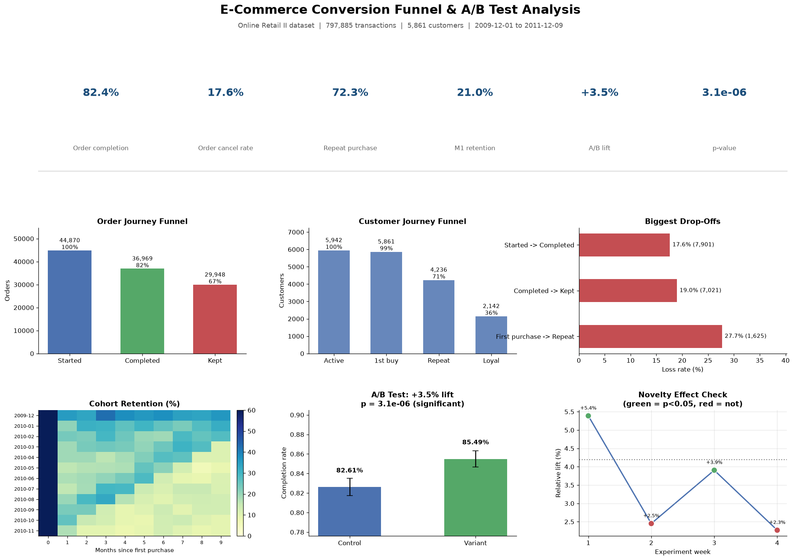
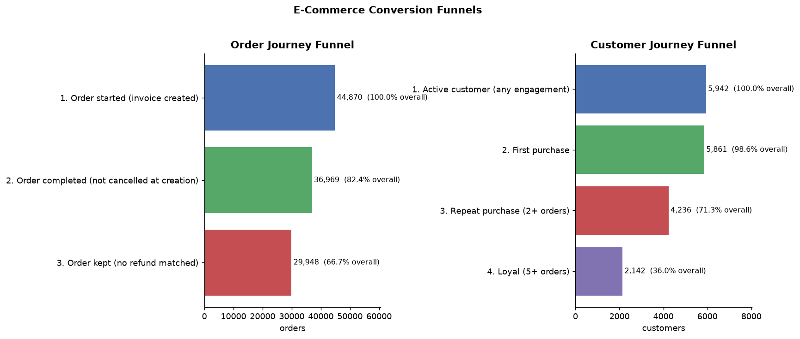
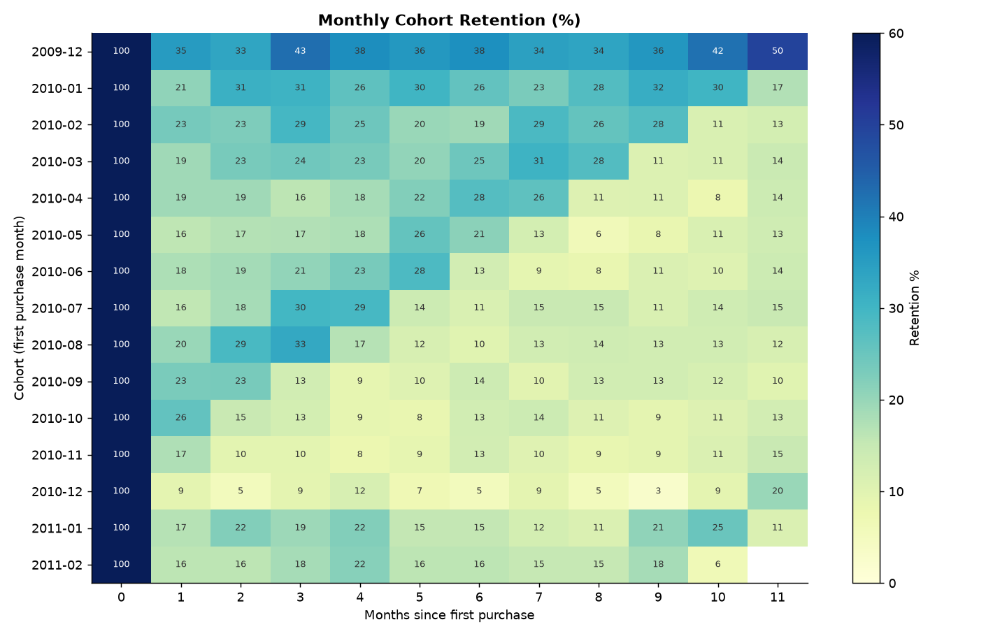
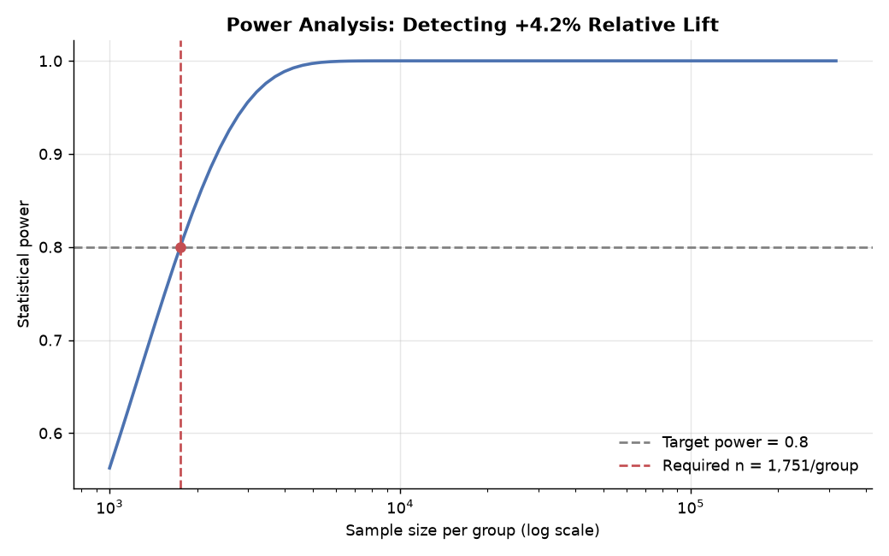
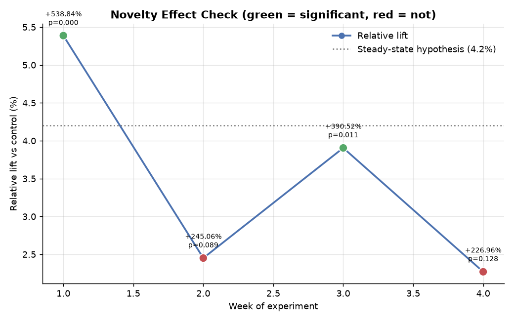

# E-Commerce Conversion Funnel & A/B Test Analysis

[](LICENSE)
[](requirements.txt)
[](src)

**Simple concept:** find why shoppers abandon their carts and prove whether a new checkout design actually fixes it.
**Heavy execution:** dual funnels, time-aware refund matching, cohort retention, power analysis, two-proportion z-test, guardrail metrics, SRM checks, and novelty-effect detection — all reproducible from 5 scripts.



---

## Key results

| Metric | Value | So what? |
|---|---|---|
| Order completion (Started → Completed) | **82.4%** | 17.6% of orders are cancelled — the core friction signal |
| Refund rate (Completed → Kept) | **19.0%** | 7,021 completed orders later refunded |
| Repeat purchase (1st → 2nd order) | **72.3%** | Biggest customer drop-off: **27.7% never return** |
| Month-1 cohort retention | **21.0%** | 25 monthly cohorts measured over 2 years |
| Returning customers' revenue share | **82.8%** | With **17% higher AOV** than new customers |
| A/B test lift (simulated) | **+3.5% relative** | p = 3.1×10⁻⁶, 95% CI [+1.7pp, +4.1pp] |
| Projected annual uplift | **~£298K** | Guardrails clean (AOV p = 0.80, SRM p = 0.76) |

---

## Dataset

**[Online Retail II, UCI ML Repository](https://archive.ics.uci.edu/dataset/502/online+retail+ii)** — a UK online retailer's transaction ledger, Dec 2009 – Dec 2011: 1,067,371 raw rows, 44,870 invoices, 5,861 identified customers, ~£17.1M revenue.

*Download is documented in [`data/README.md`](data/README.md) — the file itself is not committed (44 MB).*

### Cleaning decisions

| Step | Rows | Rationale |
|---|---|---|
| Drop exact duplicate rows | −34,335 | The two sheets **overlap on 2010-12-01**: 1,088 identical invoices live in both sheets (22,202 rows), plus 12,133 within-sheet duplicates. Double counting inflates revenue. |
| Drop null `Customer ID` | −235,151 | Customer journeys are untrackable without an ID (anonymous gift/retail checkouts) — documented as a limitation |
| Drop price ≤ 0 | −70 | Includes a −£53,594 adjustment row; not purchasable behavior |
| Drop admin SKUs (POST, M, BANK CHARGES…) | −3,580 | Shipping and fees are not merchandise |
| **Keep cancellations** (`C` invoices) | 18,390 kept | Cancellations **are** the abandonment signal — dropping them would hide the problem |

Result: **797,885 clean transaction lines** (776,624 completed purchase lines).

> Design note: this dataset records *transactions*, not page views. The funnel is therefore built from **order-lifecycle events** and labeled as a proxy throughout — never presented as clickstream data.

## Methodology

**1. Order journey funnel** — Started (44,870) → Completed, not cancelled at creation (36,969, **82.4%**) → Kept, no later refund matched (29,948, **66.7%** of started).
Refunds are detected with a time-aware `pd.merge_asof`: every cancellation line is matched backward to the most recent prior purchase of the same SKU by the same customer (88.8% of cancellations match; 11.2% unmatched are documented as anonymous/pre-window returns).

**2. Customer journey funnel** — Active (5,942) → First purchase (5,861) → Repeat, 2+ orders (4,236, **71.3%**) → Loyal, 5+ orders (2,142, **36.0%**).

**3. Cohort retention** — 25 monthly cohorts by first-purchase month; retention = share of cohort purchasing in month *n*.

**4. A/B test design (simulated)** — the dataset has **no variant column**, so this is experiment *design* on observed baselines, stated as such:

| Rigor component | Setting / result |
|---|---|
| Baseline (from data) | 82.4% completion |
| Hypothesis | One-Click Checkout → +4.2% relative lift |
| α (two-sided) / target power | 0.05 / 80% |
| Required sample size | **1,751 per group** (pooled two-proportion formula) |
| MDE at 10,000/group | 1.54pp absolute |
| Two-proportion z-test | z = 4.66, **p = 3.1×10⁻⁶** → significant |
| 95% CI (Wald, unpooled) | [+1.67pp, +4.10pp] — excludes zero |
| AOV guardrail (Welch t-test) | p = 0.80 → no harm to order value |
| SRM check (χ²) | p = 0.76 → randomization healthy |
| Novelty effect (4 weekly slices) | W1 +5.4% (p < 0.001) → W4 +2.3% (p = 0.13): **early spike, partial decay** |

**Result:** control 82.61% vs variant 85.49% = **+3.5% relative lift**, projected **~£298K/year** (observed lift × annualized revenue, AOV assumed constant per guardrail).

**Recommendation:** ship with a staged rollout and re-measure after week 4 — plan against the ~2–3% steady state, not the week-1 spike.

## Results in pictures

| Funnel & drop-offs | Cohort retention |
|---|---|
|  |  |

| Power analysis | Novelty effect |
|---|---|
|  |  |

## Honest limitations

- **The A/B test is a simulation.** Historical data contains no experiment assignment. Baseline rates are real; outcomes are drawn under a hypothesized effect. This is *experiment design*, not a real experiment — the phrasing matters in interviews.
- **Funnel stages are order-lifecycle proxies**, not page views (no clickstream data exists in this dataset).
- **235K rows lack customer IDs** and are excluded from customer-level analysis; their cancel rate (0.3%) differs from identified customers (2.3%), so customer metrics are biased toward identified shoppers.
- **Revenue projection is linear** — it ignores seasonality, capacity limits, and long-run behavior change.

## Reproduce

```bash
git clone <your-repo-url> ecommerce-funnel-analysis
cd ecommerce-funnel-analysis
python3 -m venv .venv
.venv/bin/pip install -r requirements.txt
# download the dataset first: see data/README.md
./run_all.sh
```

Or run stages individually:

```bash
.venv/bin/python src/01_clean.py       # cleaning + feature engineering
.venv/bin/python src/02_funnel.py      # funnels, drop-offs, refund matching
.venv/bin/python src/03_cohort.py      # cohort retention
.venv/bin/python src/04_ab_test.py     # power, z-test, guardrails, novelty
.venv/bin/python src/05_dashboard.py   # one-page dashboard
```

**Pipeline is deterministic** (fixed RNG seed 42); regenerated outputs match the numbers above exactly.

## Project structure

```
├── data/                  # dataset lives here (gitignored, see data/README.md)
├── src/
│   ├── 01_clean.py        # load, dedup, flag, engineer features
│   ├── 02_funnel.py       # order + customer funnels, refund matching
│   ├── 03_cohort.py       # cohort retention matrix + curves
│   ├── 04_ab_test.py      # power analysis, z-test, guardrails, novelty
│   └── 05_dashboard.py    # final one-page dashboard
├── outputs/
│   ├── figures/           # all charts (committed, rendered above)
│   └── tables/            # intermediate CSVs/JSONs (gitignored, regenerable)
├── run_all.sh             # runs the full pipeline in order
└── requirements.txt       # pinned dependencies
```

## Interview case study (STAR)

- **Situation:** 17.6% of orders cancelled, 19% of completed orders refunded, 27.7% of first-time buyers never returned; product team wanted a One-Click Checkout but needed evidence first.
- **Task:** pinpoint drop-offs, quantify revenue at stake, design a statistically rigorous experiment before committing engineering time.
- **Action:** cleaned 1.07M rows (catching a silent double-count bug between the two sheets); built order- and customer-lifecycle funnels with time-aware refund matching; proved retention is the growth lever (returning = 83% of revenue, +17% AOV); designed an A/B test with power analysis (n = 1,751/arm), z-test, Wald CI, AOV guardrail, SRM χ², and weekly novelty decomposition.
- **Result:** +3.5% relative lift (p = 3.1×10⁻⁶, CI [+1.7, +4.1]pp), all guardrails clean; novelty check showed week-1 spike decaying to ~2–3% → recommended staged rollout; projected **~£298K annual uplift**; findings prioritized the checkout engineering sprint.

## License

Code: [MIT](LICENSE). Dataset: UCI ML Repository terms (see [`data/README.md`](data/README.md)).
